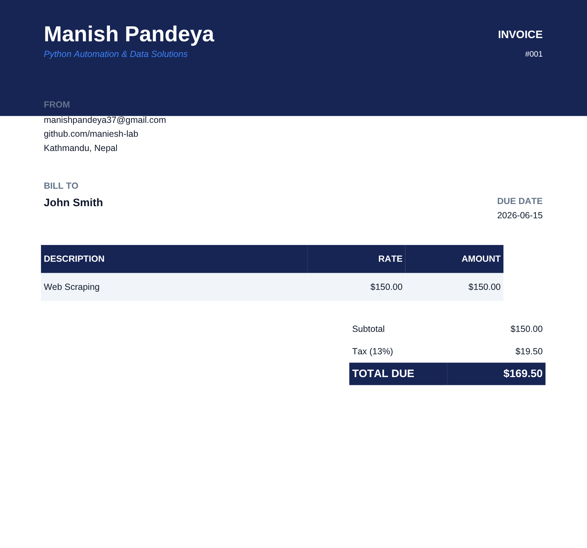

# csv-to-invoice

Automatically generate professional PDF invoices from a CSV spreadsheet.
Drop in a CSV containing client names, services, and amounts — get a polished,
ready-to-send PDF invoice per client in seconds.

---

## Features

- Generate one PDF invoice per CSV row
- Automatic tax and total calculations, done with `Decimal` and rounded to the cent (no floating-point money errors)
- CSV validation with Pydantic — names can't be blank, amounts must be positive, tax rates 0–100, due dates must be real dates
- Bad rows are skipped with a clear message (e.g. `Row 3: due_date: ...`) instead of stopping the whole batch
- Clean, professional invoice layout
- Sequential invoice numbering that continues across runs (saved in `invoice_counter.json`), so numbers are never reused and old PDFs are never overwritten
- Easy template customization


---

## Project Structure

```
csv-to-invoice/
│
├── templates/
│   ├── __init__.py
│   └── invoice_template.py    # colors, fonts, layout, sender info
│
├── processors/
│   ├── __init__.py
│   ├── reader.py              # loads and validates CSV with Pydantic
│   ├── calculator.py          # tax, subtotal, and total logic (Decimal)
│   └── numbering.py           # remembers the last invoice number between runs
│
├── generators/
│   ├── __init__.py
│   └── pdf_builder.py         # builds and exports PDF using fpdf2
│
├── input/
│   └── clients.csv            # sample input
│
├── output/                    # generated invoices land here
├── tests/                     # pytest tests for money, validation, numbering and the PDF
├── main.py                    # orchestrates the full pipeline
├── .gitignore
├── pytest.ini
├── requirements.txt
└── README.md
```

---

## How to Run

**1. Clone the repo**
```bash
git clone https://github.com/maniesh-lab/csv-to-invoice
cd csv-to-invoice
```

**2. Create and activate a virtual environment**
```bash
python -m venv venv
source venv/bin/activate
```

**3. Install dependencies**
```bash
pip install -r requirements.txt
```

**4. Add your client data to `input/clients.csv`**
```csv
client_name, service, amount, tax_rate, due_date
John Smith, Web Scraping, 150, 13, 2026-06-15
```

**5. Run the pipeline**
```bash
python main.py
```

Generated invoices appear in the `output/` folder. Any row that fails
validation is listed in the terminal and skipped; the rest are still created.

Invoice numbers pick up where the last run stopped. To start again from
`001`, delete `invoice_counter.json`.

**Run the tests**
```bash
pip install pytest
pytest
```
They check the money maths (rounding to the cent), that bad rows are skipped
with the right row number, that invoice numbers carry on between runs, and that
a real PDF is written.


---

## Sample Invoice



---

## Customization

All invoice styling lives in `templates/invoice_template.py` — update your name,
email, colors, and fonts there without touching any other file.

---


## Tech Stack

| Tool | Purpose |
|---|---|
| `pandas` | CSV reading |
| `pydantic` | Data validation |
| `fpdf2` | PDF generation |
| `pathlib` | File path handling |
| `pytest` | Tests |

---

## Use Case

Built for small business owners who manage client billing in spreadsheets and
need a fast, automated way to produce professional invoices — no manual formatting,
no per-client effort.

---

## Author

**Manish Pandeya** · [github.com/maniesh-lab](https://github.com/maniesh-lab)
